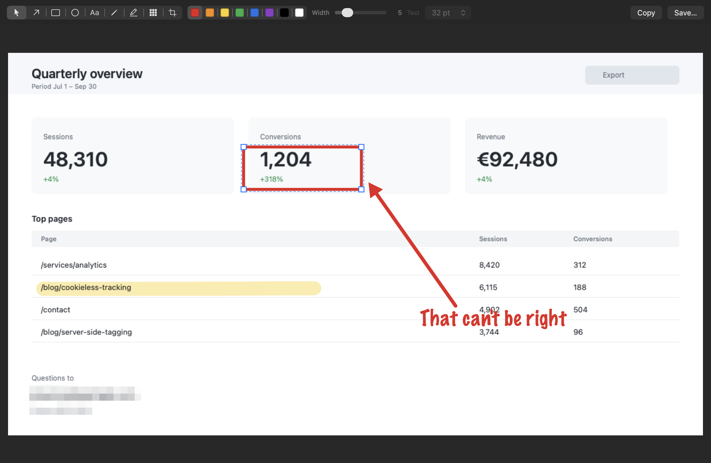

# Kritzel

A lightweight Skitch replacement for macOS. A native Swift/AppKit app with no
dependencies and no Xcode project. It exists because Skitch stops working on
upcoming macOS versions and the alternatives miss the most common case: copy an
image in some other app and annotate it right away, instead of taking a
screenshot first.

Runs on Apple Silicon Macs with macOS 13 or later. The interface is available
in English and German and follows the system language. *Kritzel* is German for
"scribble".

*Deutsche Fassung: [README.de.md](README.de.md)*



## Build and install

All you need are Apple's Command Line Tools, not Xcode:

```bash
xcode-select --install           # if not installed yet
git clone https://github.com/slarty667/kritzel.git
cd kritzel
./build.sh                       # builds Kritzel.app
cp -R Kritzel.app /Applications/
./run-tests.sh                   # render and interaction tests
```

The app is ad-hoc signed and not notarized by Apple. If you build it yourself
that does not matter. If someone sends you a ready-made `Kritzel.app`, you have
to remove the quarantine flag once, or Gatekeeper blocks it:

```bash
xattr -dr com.apple.quarantine /Applications/Kritzel.app
```

## Usage

The normal case: copy an image anywhere, switch to Kritzel, and it is already
on the canvas. If the clipboard holds no image at launch, you get a blank white
canvas.

| Key | Effect |
|---|---|
| `1`–`9` | Pick a tool: Select, Arrow, Rectangle, Ellipse, Text, Pen, Highlighter, Pixelate, Crop |
| `⌘V` | Image from the clipboard into a new window |
| `⌘⇧4` | Capture a screen selection and open it |
| `⌘N` | Blank canvas |
| `⌘O` | Open an image file (drag and drop onto the window works too) |
| `⌘S` or `⌘E` | Save dialog (PNG or JPEG) |
| `⌘C` | Copy the selected object, or the whole image if nothing is selected |
| `⌘V` | Paste the copied object, otherwise the image from the clipboard |
| `⌘⇧C` | Finished image to the clipboard |
| `⌘Z` / `⌘⇧Z` | Undo / redo |
| `⌫` | Delete the selected object |
| Arrow keys | Nudge the selection by 1 px, with `⇧` by 10 px |
| `⇧` while dragging | Arrow in 45° steps, rectangle as a square |
| `⏎` / `⎋` | Apply / cancel the crop |
| `⌥⌘I` | Resize the image |
| `⌘+` / `⌘-` | Zoom in / out |
| `⌘0` / `⌘1` | Zoom to fit / 100% |

**Crop** works like in Skitch: the frame starts on the whole image, dimmed
outside, with a rule-of-thirds grid. Eight grips (four corners, four edge
midpoints) adjust the frame, dragging inside moves it, dragging outside draws a
new one, `⇧` on a corner keeps the aspect ratio. The bar shows the pixel
dimensions for typing, next to Whole image, Cancel and Apply. The frame cannot
leave the image.

**Zoom**: `⌘+`/`⌘-` in fixed stops from 10% to 1600%, pinch on the trackpad or
`⌘` + scroll zooms around the pointer, a two-finger double tap toggles between
fitted and 100%. In a zoomed image, scrolling pans the view. From 400% up,
pixels are shown unsmoothed. A new image always starts fitted to the window.

**Retina**: macOS tags screenshots from a retina display with 144 dpi, twice as
many pixels as points. Kritzel reads that as a 2x image (the title bar says
`@2x`). Width and text size in the toolbar are points, so an arrow looks the
same on a 1x and a 2x image. 100% shows the image at its original on-screen
size. Saving and copying keep every pixel and the 144 dpi tag, so the result
appears at its original size in Mail, Pages or Keynote instead of twice as big.
A blank canvas is created at the density of the main screen.

Objects stay vectors: click, move, drag the handles, change colour and line
width afterwards, retype text with a double click. They are only burned in when
you save or copy.

In the toolbar, **Width** sets the stroke of arrow, rectangle, ellipse, pen and
highlighter; **Text** sets the point size of text objects. Whatever does not
apply right now is greyed out.

The toolbar follows the selection: click an object and the colour swatches, the
width slider and the text size show its own values. Each control writes back
only its own property, so changing the colour leaves the line width alone.

## Layout

| File | Contents |
|---|---|
| `Sources/Model.swift` | Annotation objects and the document: drawing, hit testing, handles, crop, scaling, PNG/JPEG export, undo snapshots |
| `Sources/Canvas.swift` | The canvas: rendering, mouse, selection, zoom, inline text editor, undo stack, drag and drop |
| `Sources/Editor.swift` | Window with toolbar, colour palette, width, text size |
| `Sources/Strings.swift` | `L()`: lookup of user-facing strings, the English text is the key |
| `Localization/` | One `.lproj` folder per language; `de.lproj` holds the German translation |
| `Sources/State.swift` | Window registry and clipboard access |
| `Sources/main.swift` | Menu bar, app delegate, entry point |
| `tools/makeicon.swift` | Generates the app icon at build time |
| `tools/screenshot.swift` | Renders `docs/screenshot.png` off-screen (`./make-screenshot.sh`) |
| `tests/Tests.swift` | Pixel tests of the render paths, interaction tests with synthesized mouse events, translation completeness |

## Translating

The code contains English text: `L("Zoom to Fit")`. Another language is a new
folder `Localization/<code>.lproj/` with a copy of
`de.lproj/Localizable.strings` and `InfoPlist.strings`, plus the language code
in `CFBundleLocalizations` in `Info.plist`. `./run-tests.sh` checks that the
German file misses no string and carries no leftovers.

## Why Swift and not Python

System frameworks only, no runtime, no packaging. The app survives macOS
updates for as long as AppKit exists — which is exactly why Skitch is dying:
32-bit legacy and a dead code base, not missing APIs.

## License

MIT. Use it, change it, pass it on — at your own risk, without warranty and
without support.

## Known limits

- No document format: once saved, the objects are burned into the PNG.
- Text is single-line.
